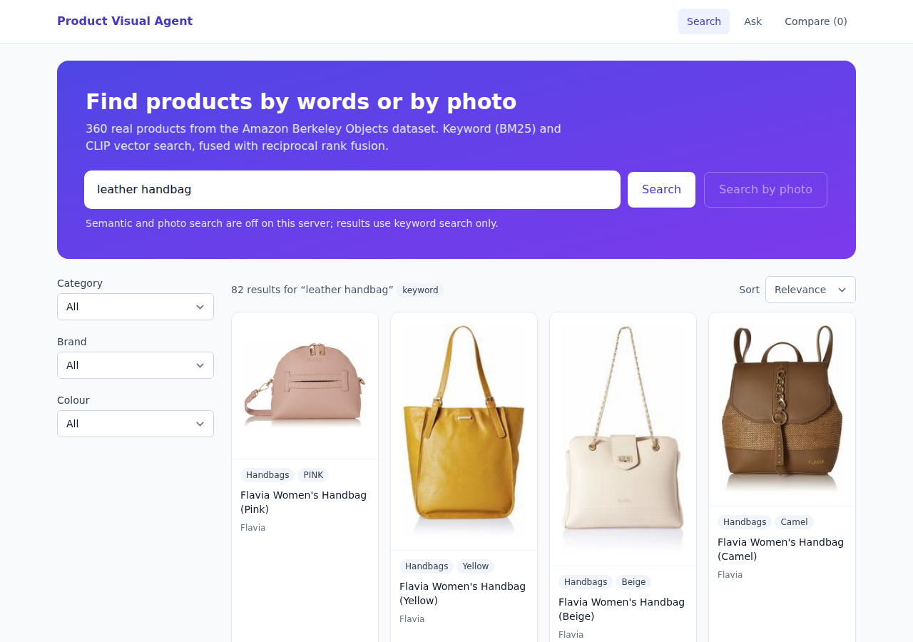
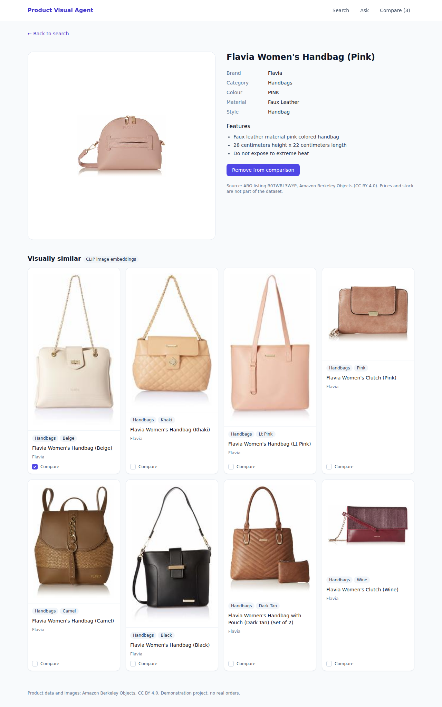
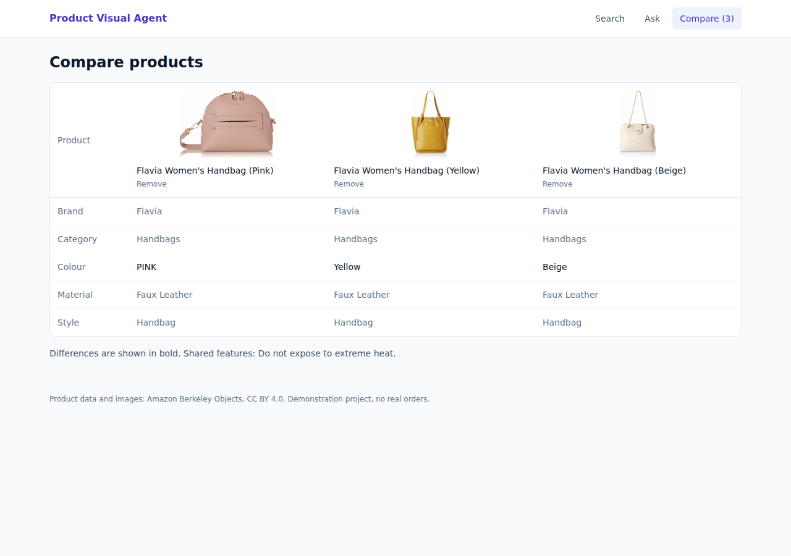
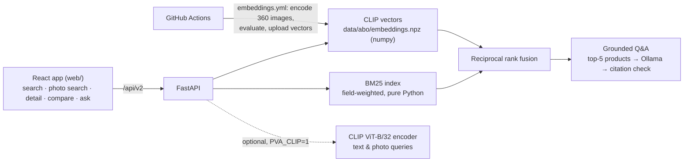

# Product Visual Agent

Multimodal product search and grounded Q&A over **360 real products** from the [Amazon Berkeley Objects](https://amazon-berkeley-objects.s3.amazonaws.com/index.html) dataset (CC BY 4.0). Search by words or by photo, browse visually similar items, compare products side by side, and ask questions that are answered only from retrieved products, with every citation checked in code.

**Status:** implemented and tested **with mocks**: 58 tests on the real catalogue use stand-in vectors and a scripted LLM. CLIP retrieval is validated with the real model in CI. Grounded Q&A was checked with a real LLM (`llama3.2:3b`) on 6 questions in CI. Not deployed.

FastAPI · BM25 + CLIP hybrid retrieval (reciprocal rank fusion) · React + TypeScript + Tailwind · Ollama · GitHub Actions for everything heavy



| Product detail with CLIP-similar items | Comparison |
|---|---|
|  |  |

*Screenshots are captured from the running app by the [screenshot workflow](.github/workflows/screenshots.yml) on a GitHub runner. That server runs without the CLIP text encoder, so search shows the keyword-only notice; "visually similar" uses the precomputed image vectors.*

## Architecture



**Why the vectors are precomputed in CI.** Encoding images needs torch and about 600 MB of model weights. The [embeddings workflow](.github/workflows/embeddings.yml) runs CLIP on a GitHub runner, evaluates the vectors, and uploads them (666 KB), and they are committed. At runtime, "visually similar" is a numpy dot product, so the default server and Docker image need no torch. Free-text semantic search and photo search encode the *query* with CLIP, so they are opt-in (`PVA_CLIP=1` + `requirements-ml.txt`). Without them the API falls back to keyword search and says so (`GET /api/v2/capabilities`).

## Measured results

**CLIP retrieval quality.** Run [40495953634](https://github.com/tanviwadgaonkar/product-visual-agent/actions/runs/40495953634), `clip-ViT-B-32`, 360 products in 12 categories. Relevance is judged only by the product category already in the data, so nothing is hand-labelled and the numbers are reproducible:

| Metric | Value | Chance |
|---|---|---|
| Image → image precision@5 (neighbours in the same category) | **0.856** | 0.083 |
| Text → image precision@10 (query "a photo of &lt;category&gt;") | **0.90** | 0.083 |

Per category, text → image is 1.0 for 9 of 12 categories, Sandals 0.8, and **Boots 0.5 and Shoes 0.5**: the two footwear categories are the weak spot. The full report is in [`data/abo/embedding_eval.json`](data/abo/embedding_eval.json). This is a category-level sanity check, not a relevance benchmark with human judgements.

**Grounded Q&A with a real model.** [Run 40498107845](https://github.com/tanviwadgaonkar/product-visual-agent/actions/runs/40498107845): CLIP hybrid retrieval + Ollama `llama3.2:3b` on a CPU runner, six fixed questions ([`scripts/qa_smoke.py`](scripts/qa_smoke.py)):

| | Result |
|---|---|
| In-catalogue questions grounded (cited only retrieved products) | 5 / 5 |
| Answered in prose (not bare IDs) | 5 / 5 |
| "Do you sell laptops?" answered without citing anything | yes: *"We don't carry that."* |
| Invented citations removed | 0 |
| Latency per answer (CPU runner) | 20–42 s |

I checked the answers by hand against the product data. The dimensions and weight limits quoted for the dining tables are in those products' feature lists. One relevance slip: for "I need a red handbag" the model offered the red Flavia bag and also the *pink* one. Six questions are a smoke test, not an evaluation; the earlier run with `llama3.2:1b` scored worse (bare IDs, cited a product for laptops; see Limitations).

## Features

| | |
|---|---|
| **Search** | Field-weighted BM25 (title ×3, brand/category/colour/style ×2); CLIP semantic; hybrid via RRF (dense limited to its top 40). Filters (category, brand, colour, case-insensitive), sorting, paging, facet counts. |
| **Photo search** | `POST /api/v2/search/image`: JPEG/PNG/WebP ≤ 5 MB, validated (415/413/400/422). |
| **Visually similar** | Nearest CLIP image vectors, excluding the product itself. |
| **Compare** | 2–4 products; attributes marked same/different; shared features. |
| **Grounded Q&A** | `POST /api/v2/ask`: retrieve top 5 → LLM answers only from them → citations of products the model was not given are removed and reported (`dropped_citations`); an answer citing nothing is flagged `grounded: false`. |
| **Errors** | One shape for every `/api/v2` error: `{"error": {"code", "message", "details"}}`. |
| **Frontend** | React 18 + TypeScript (strict) + Tailwind: loading, empty and error states, accessible labels, comparison tray kept in `localStorage`. |

## Run it

```bash
python -m venv .venv && source .venv/bin/activate      # Windows: .venv\Scripts\activate
pip install -r requirements.txt
uvicorn backend.main:app --port 8000                   # API on :8000

cd web && npm install && npm run build                  # React app, served by FastAPI at http://localhost:8000/app/
# or for development: npm run dev (proxies /api to :8000)
```

Optional:
- `pip install -r requirements-ml.txt` and `PVA_CLIP=1` for semantic and photo search.
- [Ollama](https://ollama.com) for `/api/v2/ask`, with `OLLAMA_MODEL=llama3.2:3b` or similar.

**Docker:** `docker build -t pva . && docker run -p 8000:8000 pva`. CI builds this image and smoke-tests it on every push.

## Tests and CI

```bash
pip install -r requirements-dev.txt && pytest -q       # 58 tests, ~3 s, no models, no network
cd web && npm test                                      # vitest: API client, citation parsing
```

The backend tests use the real 360-product catalogue. Vector tests use stand-in vectors (hashed title tokens), plus two checks against the committed CLIP vectors. The LLM is a scripted fake, so tests can check that invented citations are dropped and the model only sees retrieved products.

| Workflow | What it does |
|---|---|
| [CI](.github/workflows/ci.yml) | pytest on Python 3.11/3.12; web typecheck + vitest + build; Docker build + container smoke test |
| [CLIP embeddings](.github/workflows/embeddings.yml) | encodes the catalogue, writes the evaluation, smoke-tests hybrid search with the real encoder |
| [Grounded Q&A smoke](.github/workflows/qa-smoke.yml) | CLIP + Ollama `llama3.2:3b` answering six fixed questions; reports grounded / prose / out-of-catalogue handling |
| [Screenshots](.github/workflows/screenshots.yml) | Playwright captures of the running app |

## Limitations

- **"Grounded" is not "correct".** It means at least one citation and every citation was a retrieved product. It does not check that the answer is true. Dense retrieval always returns its nearest products, even for things the catalogue doesn't have. The first real-model run (llama3.2:1b) cited a product for "Do you sell laptops?" and answered with bare IDs. The prompt now asks for prose and an explicit "We don't carry that", and the smoke test measures both.
- **No relevance threshold** on vector scores yet: choosing one needs labelled queries, which this project doesn't have.
- **No prices or stock.** ABO doesn't include them, and the UI says so rather than inventing them.
- The evaluation is category-level only (see above).
- Single-user demo: no authentication on search or ask; the v1 cart and demo bookings are demonstration functionality.

## The v1 voice assistant (still included)

The original app, an on-screen character for a fictional running-shoe brand, is still served at `/`. It uses `/api/ask`, `/api/ingest`, ChromaDB and Ollama (`nomic-embed-text` + `llama3.1`). Hardening from the first rebuild is kept:
- Uploads are validated and embedded before they replace anything.
- Demo bookings only use an email the user actually typed, which guards against prompt injection from uploaded documents.
- `/api/leads` requires `ADMIN_TOKEN`.

If Ollama isn't running, the app still starts: the v1 document index is seeded on a best-effort basis, and `/api/v2` is unaffected.

**Windows:** ChromaDB (v1 only) needs the Microsoft Visual C++ 2015–2022 Redistributable.

## Data and licence

Product data and images: Amazon Berkeley Objects, © Amazon.com, licensed [CC BY 4.0](data/abo/LICENSE-CC-BY-4.0.txt); see [`data/abo/ATTRIBUTION.md`](data/abo/ATTRIBUTION.md). The subset (30 products × 12 categories) is built by [`scripts/build_catalog.py`](scripts/build_catalog.py).
