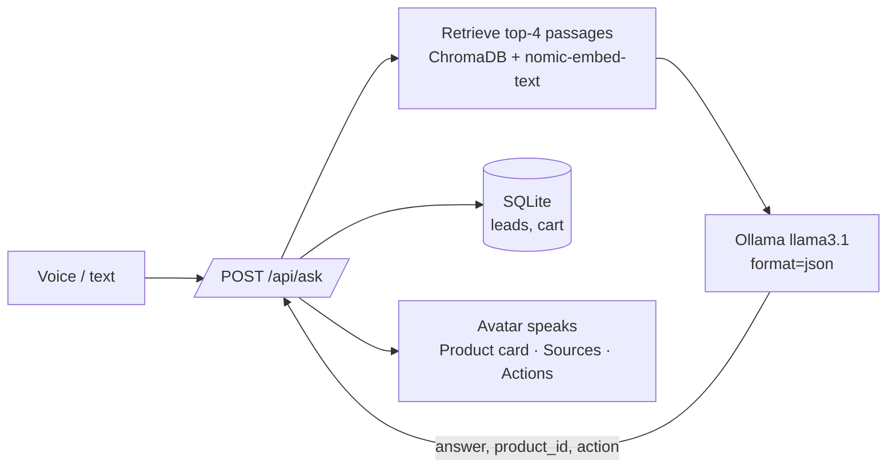

# Product Visual Agent

An on-screen character that answers questions about a brand's product catalogue by voice, shows the product it's talking about, cites the passage it used, and takes actions — booking a demo or adding to cart.

Everything runs locally: FastAPI, ChromaDB and Ollama. No API keys.


## What it does

1. You talk (or type). The browser turns speech into text.
2. The question is embedded and matched against the catalogue and store documents in ChromaDB.
3. A local LLM answers **only from those passages** and returns strict JSON: the spoken reply, the product it refers to, and an optional action.
4. The character speaks the reply (browser TTS, mouth animated while it talks), the product card and source passages render on the right.
5. If the action is `book_demo` or `add_to_cart`, the server writes it to SQLite and the UI confirms it.



## Run it

```bash
# 1. Ollama (https://ollama.com) — then pull the two models
ollama pull llama3.1
ollama pull nomic-embed-text

# 2. Python
python -m venv .venv && source .venv/bin/activate   # Windows: .venv\Scripts\activate
pip install -r requirements.txt

# 3. Start
uvicorn backend.main:app --reload --port 8000
```

Open http://localhost:8000 in Chrome or Edge (voice input uses the Web Speech API). The sample catalogue and store FAQ are indexed automatically on first start.

Change models with environment variables: `OLLAMA_MODEL` (default `llama3.1`), `OLLAMA_EMBED_MODEL` (default `nomic-embed-text`), `BRAND_NAME`, `ASSISTANT_NAME`.

## Try these

- "Which colours does the Runner Pro come in?"
- "Do you have something for trail running?"
- "What's the return policy?"
- "Add the Trail Grip to my cart"
- "Book me a demo — I'm Asha, asha@example.com"

Upload your own catalogue (CSV with `product_id,name,category,colours,sizes,price_inr,description,features`) or any `.md`, `.txt` or `.pdf` from the header.

## API

| Method | Path | Purpose |
|---|---|---|
| POST | `/api/ask` | `{question, history}` → `{answer, product, sources, action, stats}` |
| POST | `/api/ingest` | multipart file → indexes it (replaces a file with the same name) |
| GET | `/api/products` | products loaded from CSV |
| GET | `/api/leads` | demo bookings |
| GET | `/api/stats` | passage count, leads, cart items |

## Project layout

```
backend/
  main.py    FastAPI routes, action execution
  rag.py     ingestion (CSV / md / txt / pdf), chunking, ChromaDB retrieval
  agent.py   system prompt, Ollama chat with JSON output, response normalisation
  db.py      SQLite leads + cart
frontend/
  index.html avatar, mic, transcript, product card, sources, actions (vanilla JS)
data/
  catalogue.csv, store_faq.md   sample brand data (indexed on first run)
scripts/
  demo_script.md   shot list for the demo video
```

## Design notes

- Grounding is enforced twice: the prompt restricts the model to retrieved passages, and the UI always shows the passages so a wrong answer is visible, not hidden.
- Ollama's `format="json"` makes the action contract reliable enough to execute without a separate parser model; `agent.py` still normalises and rejects unknown action types.
- Product resolution falls back to the best-matching product passage when the model omits `product_id`, so the card stays in sync with the answer.
- Speech in/out is done in the browser so the backend stays a plain JSON API.

## Next steps

- Swap the SVG face for a lip-synced 3D character (Ready Player Me + viseme mapping).
- Stream the LLM response and start TTS on the first sentence to cut perceived latency.
- Replace browser TTS with a neural voice (Piper, local).
